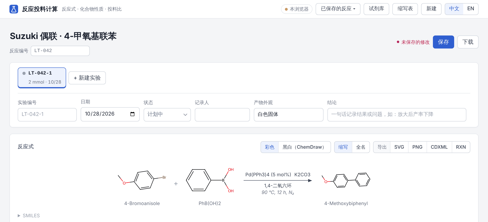
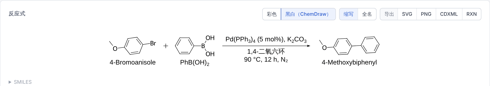
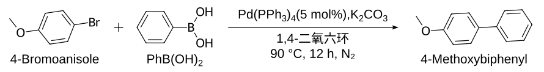
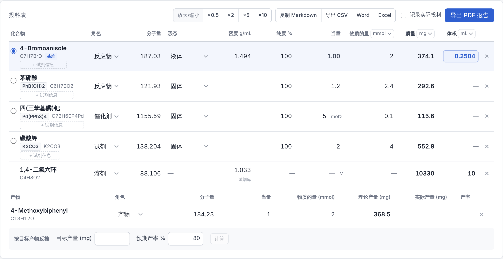
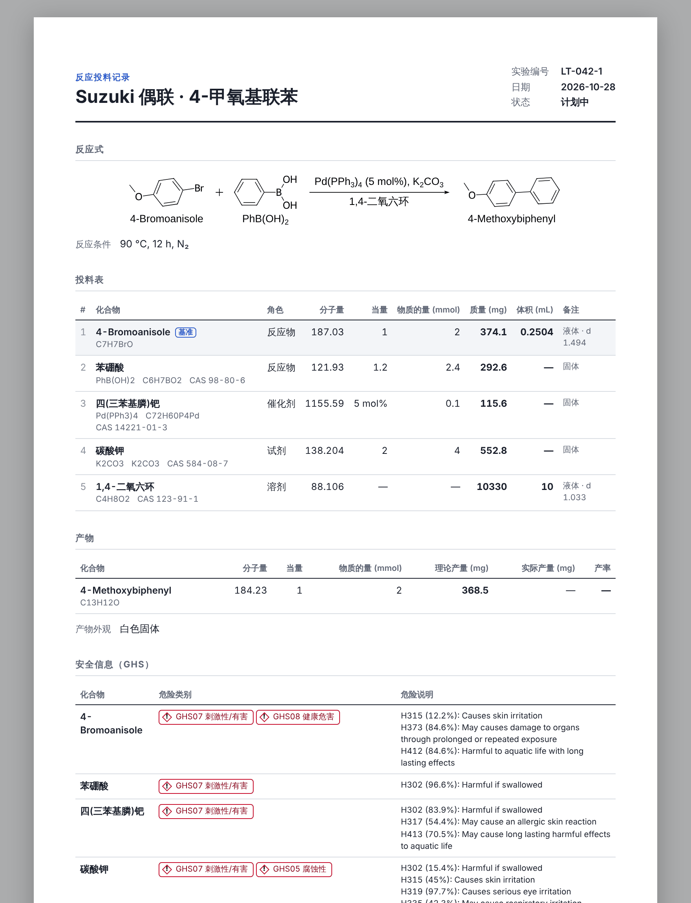
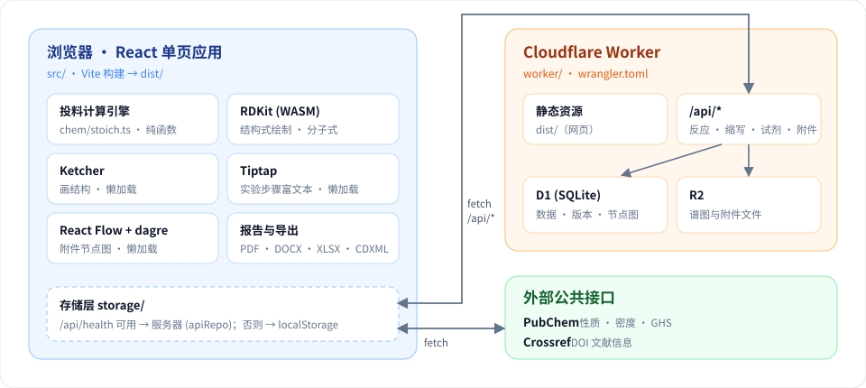

<p align="center">
  
</p>

<p align="center">
  
  
  
  
  
  
</p>

<p align="center">
  课题组内部使用的<b>反应投料计算</b>与<b>电子实验记录</b>网站（中文 / English）。<br>
  输入反应 → 自动查性质 → 算投料 → 记录多次实验 → 上传谱图 → 一键导出报告。
</p>

<p align="center">
  
</p>

---

## 目录

- [功能一览](#功能一览)
- [典型流程](#典型流程)
- [功能详解](#功能详解)
  - [反应式：输入、绘制与导出](#反应式输入绘制与导出)
  - [化合物：缩写与性质查询](#化合物缩写与性质查询)
  - [投料计算](#投料计算)
  - [实验记录](#实验记录)
  - [试剂库与试剂批次](#试剂库与试剂批次)
  - [表征与谱图](#表征与谱图)
  - [报告、导出与备份](#报告导出与备份)
- [系统架构](#系统架构)
- [后端接口](#后端接口cloudflare-worker--d1--r2)
- [本地开发](#本地开发)
- [部署到 Cloudflare](#部署到-cloudflare)
- [目录结构](#目录结构)
- [计算约定](#计算约定)
- [后续计划](#后续计划)

---

## 功能一览

<table>
  <tr>
    <td width="25%" valign="top"><br><b>反应式预览</b><br><sub>SMILES / 名称输入，RDKit 本地绘制，试剂条件自动排在箭头上下</sub></td>
    <td width="25%" valign="top"><br><b>画结构</b><br><sub>内置 Ketcher 编辑器，画反应、改结构</sub></td>
    <td width="25%" valign="top"><br><b>ChemDraw 风格导出</b><br><sub>黑白 ACS 1996 样式，SVG / PNG / CDXML / RXN</sub></td>
    <td width="25%" valign="top"><br><b>化合物缩写</b><br><sub>THF、Boc₂O、SM-1…，全组共享缩写表</sub></td>
  </tr>
  <tr>
    <td valign="top"><br><b>性质查询</b><br><sub>内置约 60 种常用试剂 + PubChem，液体自动查密度</sub></td>
    <td valign="top"><br><b>投料计算</b><br><sub>当量、物质的量、质量、体积任意联动，支持溶液、纯度、mol%</sub></td>
    <td valign="top"><br><b>多次实验</b><br><sub>一条路线多次实验，实际投料与偏差、产率</sub></td>
    <td valign="top"><br><b>实验步骤</b><br><sub>富文本，自动化学格式（CH₂Cl₂、90 °C、[M+H]⁺）</sub></td>
  </tr>
  <tr>
    <td valign="top"><br><b>试剂库</b><br><sub>实验室每一瓶试剂，Excel 导入导出，投料时直接选</sub></td>
    <td valign="top"><br><b>试剂批次与鉴定</b><br><sub>批号、标定浓度、鉴定图谱跟着这瓶试剂走</sub></td>
    <td valign="top"><br><b>表征与谱图</b><br><sub>Bruker 文件夹上传、在线看谱、MNova / PDF 附件</sub></td>
    <td valign="top"><br><b>节点图</b><br><sub>产物 → 样品 → 原始数据 → 处理文件，一目了然</sub></td>
  </tr>
  <tr>
    <td valign="top"><br><b>参考文献</b><br><sub>粘贴 DOI，Crossref 自动补全，ACS 格式</sub></td>
    <td valign="top"><br><b>PDF 报告</b><br><sub>A4 报告，含 GHS 安全信息，矢量文字</sub></td>
    <td valign="top"><br><b>Word / Excel</b><br><sub>可编辑的实验报告与投料对比表</sub></td>
    <td valign="top"><br><b>存储与备份</b><br><sub>服务器（D1）或本浏览器，全部数据一键备份</sub></td>
  </tr>
</table>

## 典型流程

<p align="center">
  
</p>

1. **输入反应**：在「导入 / 编辑」中粘贴反应 SMILES（如 `COc1ccc(Br)cc1.OB(O)c1ccccc1>Pd(PPh3)4.K2CO3>COc1ccc(-c2ccccc2)cc1`）或「名称 + 名称 -> 名称」，也可「绘制反应式」或拖入 `.mol` / `.rxn` 文件。
2. **查询性质**：分子量、CAS、密度、物态等从内置试剂库或 PubChem 自动补全。
3. **计算投料**：选一个基准物，改任意一个数，其余自动联动。
4. **记录实验**：填写日期、状态、实际称量、实验步骤和结论；同一路线可新建多次实验。
5. **上传谱图**：拖入 Bruker 文件夹或 MNova / PDF，自动挂到对应样品下。
6. **导出报告**：PDF、Word、Excel，或把反应式导出为 ChemDraw 文件。

---

## 功能详解

###  反应式：输入、绘制与导出

- **反应式预览**：输入反应 SMILES 或「名称 + 名称 -> 名称」，用 RDKit（WASM，浏览器本地运行）绘制结构式；试剂、催化剂写在箭头上方，溶剂和反应条件写在下方。
- **画结构（Ketcher）**：「绘制反应式」在页面内画出反应物、箭头和产物后导入；添加化合物时可「画结构」；性质面板中可重画已有化合物的结构。编辑器按需加载（首次约 10 MB）。
- **编辑已有反应**：
  - 「编辑反应式」在画板中打开当前反应的反应物和产物结构（试剂、催化剂、溶剂留在投料表中），修改后「更新反应式」；
  - 也可「以 SMILES 编辑」——结构相同的化合物保留已填写的当量、形态、纯度等；
  - 性质面板中可修改结构、分子式、CAS；
  - 保存时区分「保存」（覆盖）与「另存为」，并提示未保存的修改。
- **彩色 / 黑白（ChemDraw）**：反应式卡片右上角切换两种显示方式（选择会记住）。黑白模式按 ChemDraw 的 **ACS 1996** 样式绘制——键长 14.4 pt、线宽 0.6 pt、Arial 10 pt，所有结构同一比例，分子式中的数字自动下标。屏幕上看到的就是导出的图，点击化合物或试剂名同样打开性质面板。

<p align="center">
  
</p>

**导出格式**

| 格式 | 说明 |
|---|---|
| **SVG** | 矢量图，可直接插入 Word / PPT / Illustrator，插入后即为实际印刷尺寸 |
| **PNG** | 高分辨率位图（白底） |
| **CDXML** | ChemDraw 文件，结构式、箭头、试剂与条件文字均可在 ChemDraw 中继续编辑 |
| **RXN** | MDL RXN 文件（只含反应物和产物结构） |

<details>
<summary>导出的 SVG 示例（点击展开）</summary>
<br>

</details>

> [!TIP]
> Word 报告和 PDF 报告中的反应式默认为黑白样式，可在「导出 PDF 报告」窗口的「反应式样式」中选择：黑白（ChemDraw）、彩色（ChemDraw 排版，原子按元素着色）、彩色（原样式）。选择会记住，Word 报告同样适用；该窗口中也可直接导出 Word。

###  化合物：缩写与性质查询

**化合物缩写**：每个化合物可以有缩写（如 THF、Boc₂O、SM-1、1a），反应式中写缩写，卡片右上角「缩写 / 全名」切换（导出的 SVG / PNG / CDXML、Word / PDF 报告跟随这个选择）。

- 缩写来源优先级：**本反应中手动填写的**（性质面板「缩写」，只对本反应生效；也可选「不用缩写」）→ **缩写表** → **内置试剂库**（THF、DCM、TEA 等）。
- **缩写表**（顶栏「缩写表」）：自定义的缩写，服务器可用时全组共享。
  - 在性质面板填写缩写后点「存入缩写表」，以后所有反应中的同一化合物（按结构 / CAS / 名称识别）自动使用；
  - 也可在缩写表中新增（从当前反应选择，或按名称 / CAS / SMILES 查询）、修改、删除；
  - 同一缩写只能对应一个化合物，冲突时会提示。
- 输入方程式（如 `SM-1 + Boc2O -> P`）或搜索化合物时，缩写表中的缩写会识别为对应化合物。
- 投料表的化合物名下显示缩写；Word / PDF 报告的表格中名称后附缩写；缩写表包含在「全部数据备份」中。

**化合物性质查询**：内置约 60 种常用试剂/溶剂（中英文名、缩写、CAS、密度、市售规格，如 n-BuLi 2.5 M、37% 盐酸、NaH 60%），其余物质查询 PubChem（分子式、分子量、CAS、密度、熔沸点、闪点、溶解性、GHS 危险性）。

**液体自动查密度**：添加化合物后在后台查询 PubChem 的物态（物理描述、熔点、沸点）和密度；液体自动填入密度并以加料体积（mL）为主显示，查不到时提示「需密度」。密度旁标注来源（试剂库 / PubChem），可手动修改；形态可在 固体 / 液体 / 气体 / 溶液 之间切换。

###  投料计算

选定基准物（1.0 equiv），**当量 / 物质的量 / 质量 / 体积**任意一项可编辑，其余自动联动。

<p align="center">
  
</p>

- 支持纯度、密度、摩尔浓度溶液、质量分数溶液、催化剂 mol%；
- 溶剂按浓度（基准物 mol/L）或体积填写；
- 产物理论产量与产率；
- 整体放大缩小（×0.5 / ×2 / ×5 / ×10）；
- 按目标产物质量和预期产率反推投料。

计算公式见 [计算约定](#计算约定)。

###  实验记录

**保存与文件**

- 自动保存当前反应；「保存」「另存为…」把反应存入「已保存的反应」列表（服务器可用时存在服务器，否则存在本浏览器——换电脑或清除浏览器数据后不可见）；
- 「下载」把反应存为 `.json` 文件，可备份或发给组里其他人，再通过「已保存的反应 → 从文件打开」导入；
- 导出 Markdown / CSV（Excel 可直接打开）。

**多次实验**：一个反应（路线）下可以有多次实验。每次实验有自己的投料表与规模、条件、实验步骤、日期、状态（计划中 / 进行中 / 完成 / 失败）、记录人、产物外观和结论。

- 反应编号可自定义，也可自动生成（按已保存反应的编号顺延，如 `LT-042` → `LT-043`；首次保存时若为空则自动填入）；实验编号默认为「反应编号-序号」（如 `LT-042-2`），也可单独修改。
- 「新建实验」从任意一次复制投料表、规模、条件（可选是否复制步骤），实际称量、产物质量和结果清空。
- 实验进行中 / 完成后，投料表多出「实际投料」列：填写实际称量的质量（液体、摩尔浓度溶液、溶剂填体积），自动反算实际当量和与计划的偏差（**超过 5% 标红**）；产率按基准物的实际用量计算。
- 已保存的反应列表显示编号、实验次数和最高产率；PDF 报告、Markdown / CSV 导出对应当前实验。旧数据打开时自动成为「实验 1」。

**实验步骤（富文本）**

- 加粗、斜体、上下标、小标题、编号步骤、列表、注意事项、表格；「现象」块单独记录观察到的现象和结果；可全屏编辑。
- 输入时自动格式化化学文本，转换后按退格键可撤回：

  | 输入 | 结果 |
  |---|---|
  | `CH2Cl2` | CH₂Cl₂ |
  | `[M+H]+` | [M+H]⁺ |
  | `90 oC` | 90 °C |
  | `->` | → |
  | `50 uL` | 50 µL |
  | `3 x 20` | 3 × 20 |

- 「复制（SI 格式）」粘贴到 Word 时保留上下标。
- 编辑器按需加载；旧的纯文本备注打开时自动转为段落，并同时保存一份纯文本用于搜索和导出。

**参考文献**：粘贴 DOI、doi.org 链接、网址或引用文字；DOI 自动从 Crossref 补全作者、标题、期刊、卷期页，按 ACS 格式显示，并记录与本实验的关系（如参考了 SI 第几页）。

###  试剂库与试剂批次

**试剂库（实验室库存）**：顶栏「试剂库」管理实验室里实际存在的每一瓶试剂——结构与物性（分子量、形态、密度、标示浓度）、供应商 / 货号 / 批号、包装与余量、存放位置、状态（在库 / 余量不足 / 已用完 / 已报废）、到货与有效期、负责人、测定纯度或标定浓度、鉴定结论与鉴定图谱。

- 可按名称 / CAS / 货号 / 批号 / 位置搜索，按状态和位置筛选；「查询结构」按 CAS 或名称从内置试剂库 / PubChem 补全结构和分子量。
- 「导入表格」读取现有的 Excel (.xlsx) / CSV 库存表（自动识别中英文表头，如 试剂名称、CAS号、品牌、货号、批号、包装、剩余量、存放位置、状态、入库日期、浓度），可选自动查询结构；「导出 Excel」导出全部库存。
- **投料时直接选库存**：在「添加化合物」中输入名称 / CAS / 位置，先列出库存中匹配的试剂瓶，点选即加入反应，结构、分子量、密度、浓度（标定值优先）、纯度和批次一并带入；也可在试剂库中「加入反应」。已用完 / 报废的不会出现。
- 用其他方式加入的化合物，如果库存中有同一化合物（CAS / SMILES / 名称相同），投料表中会提示「选择库存（n）」，选用后补全缺少的结构和物性。

**试剂批次与鉴定**：投料表每个原料/试剂下有「试剂信息」，记录本次所用的这瓶试剂——商业试剂（供应商、规格、货号、批号）或自制（来源反应、批次号），以及到货/开封日期、测定纯度或标定浓度（如 n-BuLi 滴定为 2.31 M，**自动用于投料计算**）、鉴定结论（未鉴定 / 鉴定通过 / 有问题）和实际加入的原始记录。

- 「存入试剂库」后可在任何反应中复用：同一化合物（按 CAS / SMILES / 名称识别）会列出已有批次，点「使用」即带入；每次实验保存的是当时的快照，之后修改库不影响旧记录。
- 鉴定图谱挂在**批次**上而不是某个反应上：一瓶试剂测过一次核磁，所有用到它的反应、每次实验都能看到。

###  表征与谱图

> [!NOTE]
> 附件需要服务器存储（R2）；使用浏览器本地存储时此功能不可用。

**上传**

- 「上传 Bruker 文件夹」可选择或拖入样品文件夹或实验文件夹：按含 `acqus` 的目录拆分为各个实验，在浏览器中打包为 zip（保留 `样品/实验号/…` 结构，下载后 TopSpin / MNova 可直接打开），并从 `acqus`、`procs`、`title` 读取核、溶剂、频率、脉冲程序、实验号、标题；一维谱读取 `pdata/1/1r` 生成缩略图，可在线查看（拖选放大，双击复原）。
- 其他文件（MNova `.mnova`、PDF、图片、JCAMP、CIF 等）原样保存；PDF 和图片可在线预览。
- 文件存放在 R2：正式环境 `reaction-info-files`，PR 预览 `reaction-info-files-preview`；上传时由 R2 校验 SHA-256，单个文件上限约 95 MB。

**节点图**（桌面默认，手机默认列表，可切换）

```
原料/试剂 ──▶ 试剂批次 ──▶ 鉴定图谱
产物 ──▶ 样品 ──▶ 原始数据（Bruker 实验）──▶ 处理文件（MNova）/ 导出（PDF、图片）/ 峰列表
```

- 左侧一列是当前实验的全部化合物；多次实验时可切换「仅当前实验」。
- **自动连线**：Bruker 实验挂到同名样品节点下（不存在则新建）；MNova / PDF 等按文件名中的样品名、核（1H、13C…）、实验号猜测上游，猜不出则作为顶层节点。
- **手动连线**：拖动输出口（右侧圆点）到其他节点的输入口建立连接，一个节点可以有多个上游（如一份 MNova 同时用到 ¹H 和 ¹³C）；选中连线按 Delete 断开；不允许形成循环。
- 把文件拖到某个节点上即上传为它的下游；拖动后的节点位置会保存，「整理节点」可一键自动排布。
- 选中节点后在右侧查看详情：改名、备注、关联产物、添加峰列表（粘贴 MNova Multiplet Report，可一键插入表征数据，自动补上 `¹H NMR (400 MHz, CDCl₃) δ` 开头）、打包下载该节点及其全部下游。

**表征数据**

- 附件可关联到化合物并添加备注；产物的「表征数据（SI 格式）」可根据已上传的核磁一键插入开头（如 `¹H NMR (400 MHz, CDCl₃) δ`），并写入 PDF 报告。
- 表征数据旁显示该产物已有的谱图（¹H、¹³C、MS、2D）与缺项；PDF 报告中的附件清单按同样的树形结构列出。

###  报告、导出与备份

<table>
  <tr>
    <td width="46%" valign="top">
      
    </td>
    <td valign="top">

**PDF 报告**：「导出 PDF 报告」生成 A4 报告预览——

- 抬头含日期、记录人、实验编号；
- 反应式与条件；
- 投料表；
- 产物与产率；
- 各化合物 GHS 危险类别与 H 说明（导出时从 PubChem 获取）；
- 实验步骤。

点「保存为 PDF」后在打印对话框中选择「另存为 PDF」。由浏览器生成，文字为矢量、中文正常显示。

**Word / Excel**

- Word 报告：反应式图片、投料表、试剂信息、产物、实验步骤（含上下标与「现象」块）、表征数据、参考文献；
- Excel 工作簿：当前投料、各次实验对比、试剂批次、文献。

**全部数据备份**：「已保存的反应」菜单中可导出全部反应、试剂库和缩写表为一个 JSON 文件（谱图文件不包含，保留在 R2），并可从备份恢复（只添加缺少的，不覆盖）；也能读取浏览器版衍生版本的备份。

</td>
  </tr>
</table>

---

## 系统架构

<p align="center">
  
</p>

- 同一个 Worker 同时提供网页（`dist/`）和接口（`/api/*`，代码在 `worker/`）。
- 计算、结构绘制、Bruker 解析、报告生成都在浏览器本地完成；PubChem 和 Crossref 由浏览器直接请求。
- 保存的反应存放在 D1 数据库中，换电脑也能看到；接口不可用时（例如本地 `npm run dev`），网站自动改用浏览器本地存储，**标题栏会显示当前存储位置**。

## 后端接口（Cloudflare Worker + D1 + R2）

| 接口 | 说明 |
|---|---|
| `GET /api/health` | 健康检查（前端据此选择存储位置） |
| `GET /api/reactions?q=` | 列表（最近保存在前，可按名称 / CAS / 分子式 / SMILES 搜索） |
| `POST /api/reactions` | 新建（可带 `id`，用于上传浏览器里已有的反应） |
| `GET /api/reactions/:id` | 读取 |
| `PUT /api/reactions/:id` | 更新，需带 `baseVersion`；版本不一致返回 409 和服务器上的当前版本 |
| `DELETE /api/reactions/:id` | 删除（软删除，数据库中可恢复） |
| `GET /api/abbrs` | 缩写表 |
| `POST /api/abbrs`、`PUT /api/abbrs/:id`、`DELETE /api/abbrs/:id` | 新增、修改、删除（软删除）缩写 |
| `GET`、`POST /api/lots`；`GET`、`PUT`、`DELETE /api/lots/:id` | 试剂库 / 试剂批次 |
| `GET`、`POST /api/{reactions,lots}/:id/attachments` | 附件列表、上传（附件属于反应或试剂批次） |
| `GET`、`PATCH`、`DELETE /api/attachments/:id`；`/file`、`/preview` | 附件信息、下载原文件、缩略图 |
| `/api/{reactions,lots}/:id/{graph,nodes,links,positions}` | 节点图：读取、新建节点、连线 / 断开、保存位置 |

- 数据库表由 Worker 自动创建和升级（`worker/schema.ts`），部署流程无需额外的迁移步骤；修改表结构时在 `MIGRATIONS` 末尾追加一项即可。
- 每次保存的完整内容都记录在 `reaction_versions` 表中，便于追溯。
- 正式部署使用 `reaction-info-db`，PR 预览（`wrangler preview`）使用 `reaction-info-db-preview`，见 `wrangler.toml`。

> [!WARNING]
> 目前尚未启用登录（Cloudflare Access）：任何知道网址的人都能查看、修改和删除保存在服务器上的反应。在启用 Access 之前，请不要保存敏感数据。

## 本地开发

需要 **Node.js 20+**。

```bash
npm install          # postinstall 会把 RDKit WASM 复制到 public/rdkit/
npm run dev          # 前端开发服务器 http://localhost:5173（使用浏览器本地存储）
npm test             # 单元测试（计算引擎、分子式解析、试剂库校验等）
npm run typecheck    # 前端与 Worker 类型检查
npm run build        # 输出到 dist/
npm run dev:worker   # 构建后用本地模拟的 D1 运行 Worker：http://127.0.0.1:8787
```

## 部署到 Cloudflare

`wrangler.toml` 配置了 Worker（`main = "worker/index.ts"`）、静态资源（`[assets] directory = "./dist"`）、D1 和 R2 绑定。

**方式一：连接 GitHub（推荐，push 后自动部署）**

1. Cloudflare 控制台 → Workers & Pages → Create → Import a repository，选择本仓库。
2. Build command：`npm run build`；Deploy command：`npx wrangler deploy`（默认值即可）。
3. 部署成功后访问 `https://reaction-info.<你的子域>.workers.dev`，也可在 Settings → Domains & Routes 绑定自定义域名。

**方式二：命令行**

```bash
npx wrangler login
npm run deploy       # 构建并部署
```

**仅限课题组访问（可选）**：在 Cloudflare Zero Trust → Access → Applications 中为该 Worker 的域名添加一个应用，策略设置为允许指定邮箱（或邮箱域名）登录。50 人以内免费。

## 目录结构

<details>
<summary>展开查看</summary>

```
src/
  App.tsx, main.tsx    应用入口
  i18n.tsx             中英文文案
  useAutoLookup.ts     后台查询物态与密度
  chem/                化学计算与数据
    stoich.ts          投料计算引擎（纯函数，内部单位 mmol / mg / µL）
    formula.ts         分子式解析、分子量、Hill 式
    elements.ts        原子量表
    library.ts         常用试剂库（中英文名、密度、市售规格）
    abbr.ts            化合物缩写（来源优先级、识别）
    pubchem.ts         PubChem PUG REST / PUG View 客户端（带限速与缓存）
    ghs.ts             GHS 危险类别
    rdkit.ts           RDKit WASM 加载、结构绘制、由 SMILES 求分子式
    scheme.ts          黑白（ChemDraw / ACS 1996）反应式排版，导出 SVG / PNG / CDXML / RXN
    resolve.ts         名称 / CAS / SMILES / InChI 解析，粘贴内容 → 化合物与角色
    parseInput.ts      输入格式识别：RXN、Molfile/SDF、InChI、反应 SMILES、名称
    cdxml.ts           CDXML 解析（暂未在界面中使用）
    lots.ts            试剂批次：快照、试剂库、纯度/浓度回填
    refs.ts            参考文献格式化与 Crossref 解析
    runs.ts            多次实验：当前实验的数据在反应顶层，其余实验存于 runs[]，切换时交换
  components/          界面组件
    ReactionPreview.tsx  反应式卡片
    StoichTable.tsx      投料表
    StructureEditor.tsx  Ketcher 结构编辑器（懒加载）
    RunBar.tsx           实验切换、新建实验、当前实验信息
    LotEditor.tsx        试剂批次（本次实验）与试剂库
    Inventory.tsx        试剂库窗口（库存列表、编辑、导入 / 导出）
    AbbrTable.tsx        缩写表
    References.tsx       参考文献（DOI 查询）
    ProcedureEditor.tsx  实验步骤富文本编辑器（Tiptap，懒加载）
    Attachments.tsx      表征与谱图卡片（节点图 / 列表、上传、表征数据）
    AttachmentGraph.tsx  节点图（React Flow + dagre，懒加载）
    NodeInspector.tsx    节点详情面板
    SpectrumView.tsx     一维谱查看器
    Report.tsx           PDF 报告（A4 预览 + 打印样式）
  procedure/           步骤文档：JSON ↔ 纯文本 / 安全 HTML（doc.ts）、化学自动格式规则（chemText.ts、ChemTypography.ts）
  attachments/         Bruker 数据解析（bruker.ts）、zip、绘图、附件接口客户端；
                       graph.ts 节点关系（纯函数）、uploader.ts 上传与自动连线、pack.ts 打包下载
  inventory/
    importTable.ts     Excel / CSV 库存表解析与表头识别
  office/              Word (.docx) / Excel (.xlsx) 导出（手写 OOXML，按需加载）
  storage/             存储层
    types.ts           ReactionRepo 接口（list / get / create / update(带版本) / remove）
    index.ts           按 /api/health 自动选择服务器或本地存储
    localRepo.ts       浏览器 localStorage 实现（自动从旧格式迁移）
    apiRepo.ts         服务器实现（/api/reactions）
    upload.ts          把浏览器里已有的反应上传到服务器
    schema.ts          数据格式版本与读取时的校验/补全
    useSavedDoc.ts     当前打开的保存（id、版本、未保存修改、冲突处理）
    backup.ts          全部数据备份与恢复
    draft.ts / files.ts / ids.ts  草稿、.json 文件、UUID
worker/
  index.ts             API 路由（/api/*），其余请求交给静态资源
  schema.ts            数据库表结构与自动迁移
  reactions.ts         反应接口
  abbrs.ts             缩写表接口
  lots.ts              试剂库接口（/api/lots）
  attachments.ts       附件与节点图接口（R2 存文件，D1 存索引、连线和位置）；附件属于反应或试剂批次（lot:<id>）
docs/images/           README 使用的截图、图标与示意图
```

</details>

## 计算约定

| 类型 | 计算方式 |
|---|---|
| 非溶剂组分 | 物质的量 = 基准物 mmol × 当量 |
| 纯品 | 质量 = mmol × MW ÷ 纯度；液体（或物态未知）体积 = 质量 ÷ 密度；固体和气体不给体积 |
| 摩尔浓度溶液 | 体积 = mmol ÷ M；（填写溶液密度后）质量 = 体积 × 溶液密度 |
| 质量分数溶液 | 溶液质量 = mmol × MW ÷ wt%；体积 = 溶液质量 ÷ 溶液密度 |
| 溶剂 | 填写浓度（基准物在溶剂中的 mol/L）或直接填写体积 |
| 产物 | 当量表示化学计量比；理论产量 = 基准物 mmol × 当量 × MW |

> [!CAUTION]
> 计算结果仅供参考，请核对试剂标签与 SDS。

## 后续计划

- [ ] ChemDraw 粘贴（CDXML，代码已具备）
- [ ] 自动配平检查
- [ ] 登录与权限（Cloudflare Access）
- [ ] 常用反应模板（Suzuki、酰胺缩合、格氏反应等）
